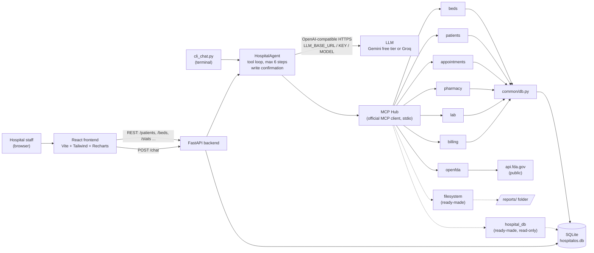
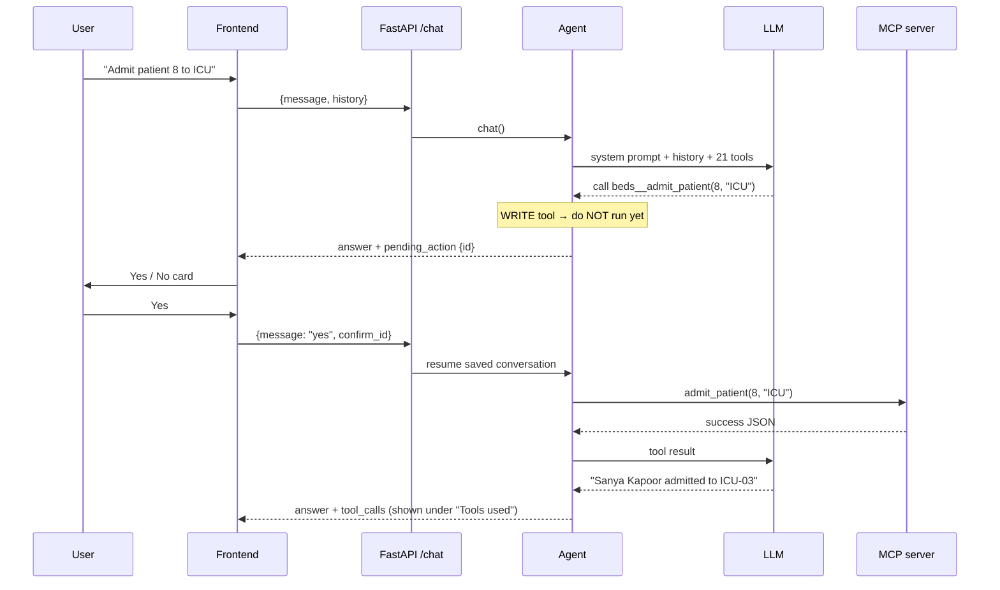

# HospitalOS — Architecture

Dotted lines = ready-made servers, enabled after you approve installing them.

## One chat question, step by step

## Key design decisions
- **One database connection module** (`backend/database.py`), reused by the API, the seed script and every MCP server.
- **Each MCP server is its own process.** If one crashes, the others keep working; the hub marks it `failed`.
- **Tool names are prefixed** with the server name (`beds__get_free_beds`), so the agent always knows where to route a call.
- **READ/WRITE is declared in each tool's docstring**; the agent reads that marker to decide when confirmation is required.
- **The LLM is replaceable**: plain HTTP to `/chat/completions`, no vendor SDK.
